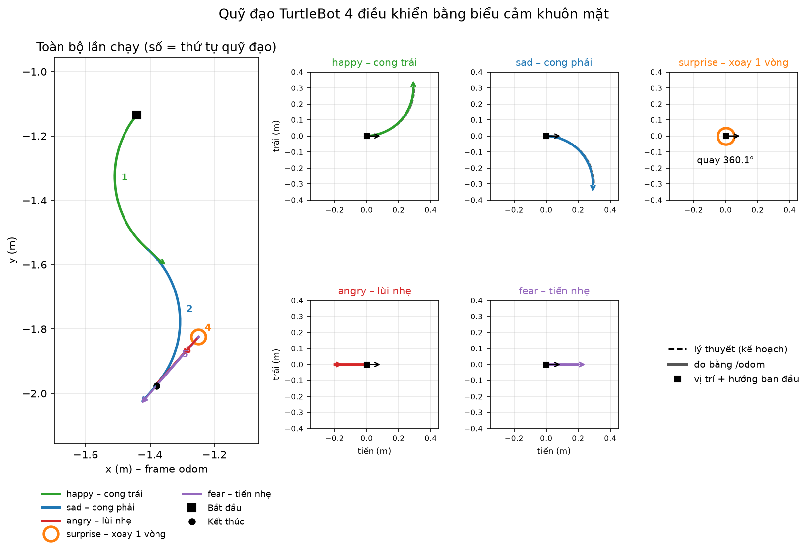

# TurtleBot 4 – Nhận diện biểu cảm khuôn mặt và điều khiển robot (Bài 8)

ROS 2 Humble · Ignition Gazebo Fortress · TurtleBot 4 Simulator · OpenCV · DeepFace (ONNX) / FER

Webcam → **`emotion_recognition_node`** (phát hiện mặt bằng OpenCV + phân loại 7 biểu cảm bằng DeepFace hoặc FER,
lọc nhiễu theo thời gian, cửa sổ hiển thị thời gian thực) → `/detected_emotion` → **`emotion_behavior_node`**
(máy trạng thái + bộ chạy quỹ đạo đo bằng `/odom`) → **`/cmd_vel`** → TurtleBot 4 trong Gazebo.

| Biểu cảm | Quỹ đạo (mặc định, sửa trong `config/emotion.yaml`) | Đo trong Gazebo (`/odom`) |
|---|---|---|
| **Happy** | cung tròn sang **trái**, r = 0,30 m, quay 90° (v = 0,15 m/s, ω = +0,5 rad/s) | quay +90,1°, r = 0,296 m, lệch trái +0,301 m |
| **Sad** | cung tròn sang **phải**, r = 0,30 m, quay 90° | quay −90,1°, r = 0,296 m, lệch phải −0,301 m |
| **Neutral** | **dừng tại chỗ** (huỷ quỹ đạo đang chạy) | robot dừng, trôi thêm ≤ 5° do quán tính |
| **Angry** | **lùi nhẹ** 0,20 m (0,10 m/s) | lùi 0,199 m, lệch ngang 0,000 m |
| **Surprise** | **xoay một vòng** 360° tại chỗ (1,0 rad/s) | quay 360,1°, dịch chuyển 0,000 m |
| **Fear** | **tiến nhẹ** 0,20 m (0,10 m/s) | tiến 0,199 m |
| Disgust | không có trong đề → không làm gì | – |
| Không thấy mặt | dừng (tắt được: `stop_on_no_face:=false`) | – |



| Yêu cầu của đề | Làm thế nào | Bằng chứng |
|---|---|---|
| Nhận diện biểu cảm qua webcam, DeepFace hoặc FER + OpenCV | `emotion_recognition_node.py`: Haar cascade (OpenCV) tìm mặt → DeepFace (engine ONNX, mặc định) **hoặc** FER (`backend:=fer`) | log `Biểu cảm ổn định: happy`, topic `/detected_emotion/info` |
| 6 trạng thái → 6 quỹ đạo | `emotion_logic.build_emotion_plan()` + `SegmentRunner` (Bài 6): đo quãng đường/góc bằng `/odom`, tăng/giảm tốc mượt | bảng trên, `plot_emotion_run.py` → `trajectory.png`, `summary.csv` |
| Điều khiển qua ROS 2, topic `/cmd_vel` | `emotion_behavior_node.py` publish `geometry_msgs/Twist` 20 Hz | `ros2 topic echo /cmd_vel` |
| Hiển thị hình ảnh camera + kết quả theo thời gian thực | cửa sổ OpenCV: khung mặt + nhãn + %, thanh xác suất 7 lớp, biểu cảm ổn định, hành động, trạng thái robot, FPS | cửa sổ *Emotion Recognition - TurtleBot 4* |
| Chạy mượt, không lỗi | bộ lọc chống rung nhãn, chỉ kích hoạt khi biểu cảm ĐỔI, watchdog, LiDAR dừng trước vật cản, mọi lỗi khung hình/callback được bắt | 50 unit test Bài 8 + test Gazebo (mục 6) |

Repo vẫn giữ các bài trước (vẫn chạy được): Bài 7 giọng nói [`docs/LAB07_VOICE_README.md`](docs/LAB07_VOICE_README.md),
Bài 6 cử chỉ tay [`docs/LAB06_GESTURE_README.md`](docs/LAB06_GESTURE_README.md), Bài 5 Nav2 + YOLO
[`docs/LAB05_NAV2_YOLO_README.md`](docs/LAB05_NAV2_YOLO_README.md), Bài 4 SLAM [`docs/LAB04_SLAM_README.md`](docs/LAB04_SLAM_README.md).
Bài 8 dùng lại môi trường mô phỏng của Bài 6 (world `gesture_arena`: sân phẳng 9 × 9 m, không vật cản).

**Hướng dẫn chạy từng bước (cài đặt → demo → quay video): [`HUONG_DAN_CHAY_TUNG_BUOC.md`](HUONG_DAN_CHAY_TUNG_BUOC.md).**
Danh sách lệnh ngắn gọn: [`HUONG_DAN_NHANH.md`](HUONG_DAN_NHANH.md).

---

## Mục lục

0. [Đọc trước](#0-đọc-trước)
1. [Cài đặt](#1-cài-đặt)
2. [Kiến trúc](#2-kiến-trúc)
3. [Nhận diện biểu cảm](#3-nhận-diện-biểu-cảm)
4. [Điều khiển robot](#4-điều-khiển-robot)
5. [Chạy demo](#5-chạy-demo)
6. [Kết quả kiểm thử](#6-kết-quả-kiểm-thử)
7. [Xử lý sự cố](#7-xử-lý-sự-cố)
8. [Giới hạn đã biết](#8-giới-hạn-đã-biết)

---

## 0. Đọc trước

1. **Không chạy thẳng `pip install deepface` / `pip install fer`.** Hai gói đó kéo theo OpenCV *headless* (cửa sổ
   OpenCV không mở được), TensorFlow/PyTorch vài GB và có thể NumPy 2.x (làm hỏng `cv_bridge` của Humble). Dùng
   `bash scripts/install_emotion_deps.sh` – script cài đúng phần cần dùng, ghim phiên bản đã kiểm thử và tự kiểm tra.
2. **Mặc định dùng DeepFace (engine ONNX Runtime)**: nhẹ (~60 MB), ~2–4 ms/mặt trên CPU. Lần chạy đầu cần Internet để
   tải trọng số 6 MB từ GitHub vào `~/.deepface/weights` (script cài đặt đã tải sẵn). FER là phương án thay thế
   (`backend:=fer`, trọng số đi kèm gói, cần TensorFlow ~600 MB: `install_emotion_deps.sh --with-fer`).
3. **Mỗi lần biểu cảm ĐỔI → robot chạy MỘT quỹ đạo** (mode `once`). Giữ nguyên nụ cười thì robot không cong trái mãi;
   muốn chạy lại: trở về mặt bình thường (neutral – robot dừng) rồi cười lại. Muốn lặp liên tục khi còn giữ biểu cảm:
   `mode:=repeat`. Lý do chọn mặc định này: xem mục 4.2.
4. **Neutral = dừng ngay.** Đây cũng là "nút dừng khẩn" khi demo. Rời khỏi camera (không thấy mặt) cũng dừng.
5. **Robot khởi động trong dock**: `emotion_behavior_node` tự undock + chạy thẳng 1 m ra giữa sân (log
   `Da ra giua san - san sang nhan bieu cam`). Trong lúc đó biểu cảm bị bỏ qua; biểu cảm đang giữ được thực hiện ngay
   khi xong.
6. **Mô hình nhận biểu cảm "diễn" tốt hơn biểu cảm tự nhiên.** Happy, surprise, neutral nhận rất ổn; angry, sad, fear
   cần làm rõ (nhíu mày, trề môi, mở to mắt + há miệng). Mục 8 nói rõ vì sao.

---

## 1. Cài đặt

Đã có ROS 2 Humble + TurtleBot 4 Simulator từ các bài trước (nếu chưa: [`docs/LAB04_SLAM_README.md` mục 1](docs/LAB04_SLAM_README.md#1-cài-đặt-làm-một-lần)).

```bash
cd ~/workspaces/tb4_gazebo/src/tb4_lab04
bash scripts/install_emotion_deps.sh              # DeepFace + ONNX Runtime (khuyên dùng)
# bash scripts/install_emotion_deps.sh --with-fer # nếu muốn thêm FER (TensorFlow CPU)
cd ~/workspaces/tb4_gazebo && colcon build --symlink-install --packages-select tb4_lab04 && source install/setup.bash
```

Kết quả đúng của script: các dòng `[PASS] numpy: 1.26.x`, `[PASS] cv2 (có GUI)`, `[PASS] Haar cascade`, `[PASS] DeepFace`
và `KẾT QUẢ: TẤT CẢ OK`. Dòng đỏ `ERROR: pip's dependency resolver ... deepface requires retina-face ...` là **bình
thường** (cố ý không cài các gói đó).

Phiên bản đã kiểm thử cùng nhau (Python 3.10, cùng môi trường với MediaPipe của Bài 6 – Bài 6 vẫn chạy):
numpy 1.26.4 · opencv-python 4.10.0.84 · deepface 0.0.105 · onnxruntime 1.23.2 · fer 25.10.3 · tensorflow-cpu 2.19.1 ·
mediapipe 0.10.21 · protobuf 4.25.

---

## 2. Kiến trúc

```
 webcam ──► emotion_recognition_node ──/detected_emotion (String, mỗi khung)──► emotion_behavior_node ──/cmd_vel──► TurtleBot 4
  640x480     │ Haar cascade (OpenCV)                                              │ EmotionController       (Gazebo)
              │ FaceTracker (1 người)                                              │ SegmentRunner ◄── /odom
              │ DeepFace | FER (7 lớp)       ◄──/emotion_behavior/state (JSON)────┤ an toàn ◄── /scan, watchdog
              │ EMA + EmotionStabilizer                                            │ undock ──► /undock (action)
              ▼                                                                    ▼
        cửa sổ OpenCV                                                     ~/tb4_results/emotion_<thời gian>/
```

| File | Vai trò |
|---|---|
| `scripts/emotion_recognition_node.py` | webcam/video/thư mục ảnh → mặt → biểu cảm → `/detected_emotion`, `/detected_emotion/info`; cửa sổ hiển thị |
| `scripts/emotion_backends.py` | `FaceDetector` (Haar), `FaceTracker`, `DeepFaceBackend`, `FerBackend`, vá tương thích (`pkg_resources`, `cv2.data`) |
| `scripts/emotion_logic.py` | thuần Python, có unit test: chuẩn hoá xác suất, nhãn khung, bộ lọc, quỹ đạo, `EmotionController` |
| `scripts/emotion_behavior_node.py` | máy trạng thái → `/cmd_vel`; undock, LiDAR, watchdog, ghi `events.csv`/`odom.csv` |
| `scripts/emotion_sequence.py` | phát chuỗi biểu cảm giả (kiểm thử không cần webcam) |
| `scripts/plot_emotion_run.py` | đo + vẽ quỹ đạo từ `odom.csv` (bảng số đo + ảnh) |
| `launch/emotion.launch.py` · `emotion_demo.launch.py` | 2 node · Gazebo + 2 node trong 1 lệnh |
| `config/emotion.yaml` | toàn bộ tham số (có chú thích) |
| `models/haarcascade_frontalface_default.xml` | bộ phát hiện mặt của OpenCV (giấy phép Intel/BSD giữ trong file) |
| `test/test_emotion_logic.py` | 50 unit test |

Topic: `/detected_emotion` (`std_msgs/String`: `happy`, `sad`, `neutral`, `angry`, `surprise`, `fear`, `disgust`,
`no_face`), `/detected_emotion/info` (JSON: nhãn khung, độ tin cậy, xác suất 7 lớp, khung mặt, FPS, ms/khung),
`/emotion_behavior/state` (JSON trạng thái robot), `/cmd_vel`, `/emotion/image` (tuỳ chọn `publish_image:=true`).

---

## 3. Nhận diện biểu cảm

Mỗi khung hình:

1. **Phát hiện mặt** – Haar cascade trên ảnh xám thu nhỏ còn 320 px (nhanh), cân bằng histogram. Chọn mặt theo **điểm
   tin cậy** (`levelWeights`) chứ không theo diện tích: khi thử, Haar báo nhầm một vùng lớn trên áo với điểm 1,2 trong
   khi mặt thật điểm 5,7 – chọn theo diện tích sẽ phân loại nhầm vùng áo thành "angry 99 %".
2. **Bám một người** (`FaceTracker`) – ưu tiên mặt trùng (IoU) với mặt đang theo (người khác đi ngang không cướp quyền
   điều khiển), làm mượt khung, Haar trượt vài khung (nghiêng đầu) thì giữ khung cũ 0,3 s thay vì báo mất mặt.
3. **Phân loại 7 lớp** – DeepFace (`DeepFace.analyze(actions=['emotion'], detector_backend='skip')` trên vùng mặt nới
   10 %) hoặc FER (`detect_emotions(face_rectangles=[...])`). Hai backend dùng **chung** bộ phát hiện mặt nên so sánh được.
4. **Làm mượt xác suất** (EMA, `prob_alpha` 0,5) → **nhãn khung**: lớp cao nhất < 40 % hoặc hơn lớp thứ hai < 10 điểm
   % → `unknown` (không bỏ phiếu, giữ nhãn cũ).
5. **Biểu cảm ổn định** (`EmotionStabilizer`) – một nhãn chỉ được chấp nhận khi chiếm ≥ 60 % số khung trong 0,6 s
   gần nhất (neutral 0,4 s, không thấy mặt 0,5 s). Một vài khung nhận nhầm không làm robot đổi hành vi.
6. Publish nhãn ổn định **mỗi khung** – vừa là lệnh, vừa là "nhịp tim" cho watchdog của robot.

Cửa sổ hiển thị: ảnh camera (lật gương), khung mặt màu theo biểu cảm + nhãn + %, bảng bên phải: biểu cảm ổn định (tiếng
Việt không dấu), hành động tương ứng, tỉ lệ phiếu, thanh xác suất 7 lớp, trạng thái robot (`EXECUTING happy 45 %`),
chú giải, FPS và tên backend. Phím `q`/`Esc` đóng node. Không có màn hình (SSH, Xvfb tắt) → node tự chạy không cửa sổ
thay vì bị Qt huỷ tiến trình.

Đổi backend: `backend:=fer` (FER), `backend:=auto` (thử DeepFace, lỗi thì FER).

---

## 4. Điều khiển robot

### 4.1 Quỹ đạo

Mỗi quỹ đạo là danh sách `Segment` (tái dùng Bài 6) chạy bởi `SegmentRunner`: đo tiến độ bằng `/odom` (quãng đường
cho tiến/lùi, góc tích luỹ cho cung tròn và xoay), giới hạn gia tốc 0,5 m/s² / 2 rad/s², giảm tốc gần đích (không vọt).
Cung tròn giữ đúng tỉ lệ v/ω khi giảm tốc nên vẫn đúng bán kính. Thời gian (kẹt, quá giờ) tính theo **giờ mô phỏng**
(stamp của `/odom`) → máy yếu, Gazebo chạy chậm không bị báo lỗi oan.

### 4.2 Khi nào chạy (`EmotionController`)

1. `neutral` → dừng ngay. 2. Không thấy mặt → dừng (`stop_on_no_face`). 3. Biểu cảm có quỹ đạo, **khác** biểu cảm vừa
kích hoạt → chạy quỹ đạo mới; đang chạy quỹ đạo khác thì **ngắt và chuyển** (giảm tốc mượt từ vận tốc hiện tại).
4. Giữ nguyên biểu cảm → không lặp (`mode: once`) hoặc lặp sau 1 s (`mode: repeat`). 5. `unknown`, `disgust` → không
đổi gì. Hai lần kích hoạt cách nhau ≥ 0,5 s.

Vì sao mặc định `once`: hiểu đề theo kiểu "giữ biểu cảm = robot chạy liên tục" thì giữ mặt giận 10 s robot lùi 1 m+ (không
còn là "lùi nhẹ") và giữ nụ cười thì robot quay tròn mãi; khó quay video rõ từng biểu cảm. `once` cho mỗi biểu cảm đúng
một quỹ đạo nhỏ, dễ kiểm chứng. Nếu giảng viên hiểu đề theo nghĩa "liên tục" → `mode:=repeat`.

### 4.3 An toàn

Watchdog 1 s (node nhận diện chết, webcam rút ra, hết video → dừng); LiDAR: vật cản < 0,40 m theo hướng đang chạy (kể
cả khi lùi) → dừng; robot kẹt 4 s hoặc quá thời gian → dừng; robot còn trong dock thì không chạy quỹ đạo có tiến (húc
dock); Ctrl+C → gửi Twist 0; mọi ngoại lệ trong callback được bắt, robot dừng thay vì mất điều khiển.

---

## 5. Chạy demo

```bash
# Cách 1 – một lệnh: Gazebo + 2 node (node biểu cảm bật khi mô phỏng chạy thật)
ros2 launch tb4_lab04 emotion_demo.launch.py
# Cách 2 – hai terminal (quay video nên dùng cách này)
ros2 launch tb4_lab04 gesture_sim.launch.py                 # Terminal 1: Gazebo, sân trống
ros2 launch tb4_lab04 emotion.launch.py window_position:=1000,0   # Terminal 2: webcam + robot
```

Tuỳ chọn hay dùng: `camera_source:=1` (webcam USB), `backend:=fer`, `mode:=repeat`, `stop_on_no_face:=false`,
`run_behavior:=false` (chỉ thử nhận diện), `software_render:=true` (Gazebo crash/đen màn hình).

Kiểm thử không cần webcam: `ros2 run tb4_lab04 emotion_sequence.py --ros-args -p preset:=all` (đủ 6 biểu cảm, chờ
từng quỹ đạo chạy xong), `preset:=interrupt` (neutral dừng giữa chừng, biểu cảm mới ngắt quỹ đạo cũ, rời camera),
`preset:=hold`, `preset:=lost`. Chạy với `run_recognition:=false`.

Sau mỗi lần chạy: `ros2 run tb4_lab04 plot_emotion_run.py` → bảng số đo + `~/tb4_results/emotion_<thời gian>/trajectory.png`.

---

## 6. Kết quả kiểm thử

Thực hiện trong môi trường mô phỏng của repo (Gazebo Fortress, TurtleBot 4 standard, world `gesture_arena`,
render phần mềm, real-time factor ≈ 0,07 – rất chậm so với máy thật).

| Kiểm thử | Kết quả |
|---|---|
| Unit test (`python3 -m pytest test/ -q`) | 50 test Bài 8 + test các bài trước: tất cả đạt (test cần DeepFace/FER/ROS tự bỏ qua nếu thiếu) |
| Cài đặt sạch (venv Python 3.10 có sẵn MediaPipe 0.10.21 của Bài 6) bằng `install_emotion_deps.sh --with-fer` | `TẤT CẢ OK`; DeepFace, FER, MediaPipe cùng chạy; OpenCV vẫn có GUI |
| Gazebo, `preset:=all` (6 biểu cảm) | 5 quỹ đạo đúng như bảng đầu trang; sai số ≤ 1 mm, ≤ 0,1°; neutral dừng |
| Gazebo, `preset:=interrupt` | neutral dừng giữa vòng xoay; happy ngắt surprise rồi chạy đủ 90°; rời camera → dừng |
| Gazebo, `preset:=hold` / `lost` | giữ happy 6 s chỉ chạy 1 lần; mất tín hiệu giữa vòng xoay → dừng sau 1 s |
| Toàn hệ thống: node nhận diện (DeepFace) đọc ảnh mặt → node điều khiển → Gazebo | neutral → happy → robot cong trái 90°; neutral; sad → cong phải 90°; không mặt → no_face; hết ảnh → mất tín hiệu, robot dừng |
| Tốc độ nhận diện (DeepFace, CPU, 640×480) | 24 ms/khung (phát hiện + phân loại) khi máy rảnh → ~30 FPS từ webcam; 40–80 ms khi Gazebo render phần mềm chiếm CPU |
| Độ trễ đổi biểu cảm → lệnh `/cmd_vel` | ~0,5–0,7 s (do bộ lọc giữ 0,6 s – cố ý, để chống rung) |

Lỗi tìm ra và đã sửa trong quá trình kiểm thử: (1) Haar chọn nhầm vùng lớn → chọn theo điểm tin cậy; (2) rclpy cấm đổi mức
log ở cùng một dòng gọi → node nhận diện chết khi FPS dao động quanh ngưỡng cảnh báo; lỗi này **cũng có sẵn trong Bài 6**
(luồng camera chết khi webcam mở lại sau khi lỗi; bước chuẩn bị báo lỗi rồi thành công) → đã sửa cả Bài 6 bằng
`gesture_logic.log_at()` và thêm test chặn mẫu code này; (3) Qt huỷ tiến trình khi không có màn hình → kiểm tra trước.

---

## 7. Xử lý sự cố

| Hiện tượng | Cách xử lý |
|---|---|
| `Không khởi tạo được backend ... No module named 'deepface'` | `bash scripts/install_emotion_deps.sh`; không ở trong conda/venv khác |
| Treo ở `nạp mô hình emotion` / lỗi tải trọng số | máy không ra được GitHub: tải `facial_expression_model_weights.onnx` (release v1.0 của serengil/deepface_models) ở máy khác, chép vào `~/.deepface/weights/`; hoặc `backend:=fer` |
| Cửa sổ không hiện, log `Không có màn hình` | chạy trong terminal của giao diện Ubuntu (không qua SSH); `echo $DISPLAY` phải có giá trị |
| `cv2.imshow` lỗi / không có cửa sổ, `OpenCV ... KHÔNG có GUI` | có gói headless: `pip3 uninstall -y opencv-python-headless opencv-contrib-python-headless` rồi chạy lại script cài |
| Khung mặt không hiện | đủ sáng, nhìn thẳng camera, cách 0,5–1,5 m; mặt nhỏ/xa: `detect_width:=480 min_face:=40` |
| Nhãn nhảy liên tục | tăng `hold_time` (0,8–1,0), `min_confidence` (0,5); kiểm tra ánh sáng ngược |
| Robot không chạy dù nhãn đúng | xem trạng thái trên cửa sổ: `SETUP` (đang undock – chờ), cùng biểu cảm đã chạy rồi (mode once → về neutral trước), `robot dang o dock` (undock thất bại: `ros2 action send_goal /undock irobot_create_msgs/action/Undock "{}"`) |
| `SIGNAL_LOST` | node nhận diện không publish: webcam lỗi / đã đóng cửa sổ; `ros2 topic hz /detected_emotion` |
| FPS < 8 | `max_fps:=15`, đóng ứng dụng khác; Gazebo + nhận diện cùng máy yếu: `software_render` chỉ bật khi cần |
| `numpy` 2.x sau khi cài gói khác | `pip3 install --user "numpy<2"` |

---

## 8. Giới hạn đã biết

- **Độ chính xác của mô hình trên khuôn mặt người thật chưa được đo trong repo** (môi trường kiểm thử không có webcam).
  Cả DeepFace và FER đều huấn luyện trên FER-2013 (ảnh 48×48 xám); độ chính xác công bố của loại mô hình này chỉ khoảng
  55–70 % trên tập test, kém nhất ở *fear* và *disgust* (hay nhầm với sad/surprise/angry). Trên 41 ảnh mặt mẫu (phần lớn
  cười hoặc bình thường), DeepFace và FER **đồng ý 66 %** – chủ yếu lệch ở nụ cười nhẹ (một bên neutral, một bên happy),
  và một nụ cười mỉm bị DeepFace gọi là sad 89 %. Vì vậy: biểu cảm cần rõ ràng, và nên tự đo trên mặt mình
  (`/detected_emotion/info`) trước khi quay video.
- Haar cascade chỉ bắt mặt **nhìn thẳng**; quay nghiêng > ~30° sẽ mất mặt → robot dừng (đúng thiết kế an toàn).
- Quỹ đạo đo bằng odometry bánh xe (trong Gazebo gần như lý tưởng); robot thật sẽ trượt vài %.
- Không có giới hạn vùng hoạt động ngoài LiDAR: chạy nhiều lần cùng một biểu cảm robot có thể đi xa dần (sân 9 × 9 m
  đủ rộng cho vài chục quỹ đạo).
